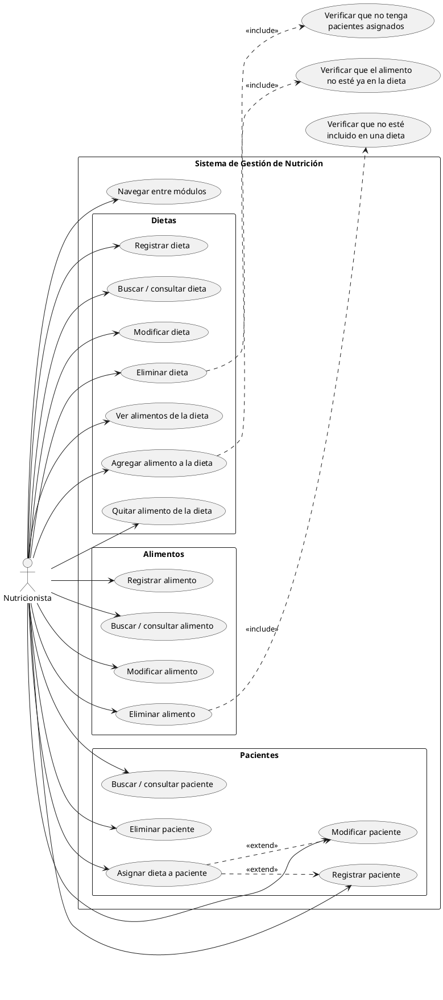
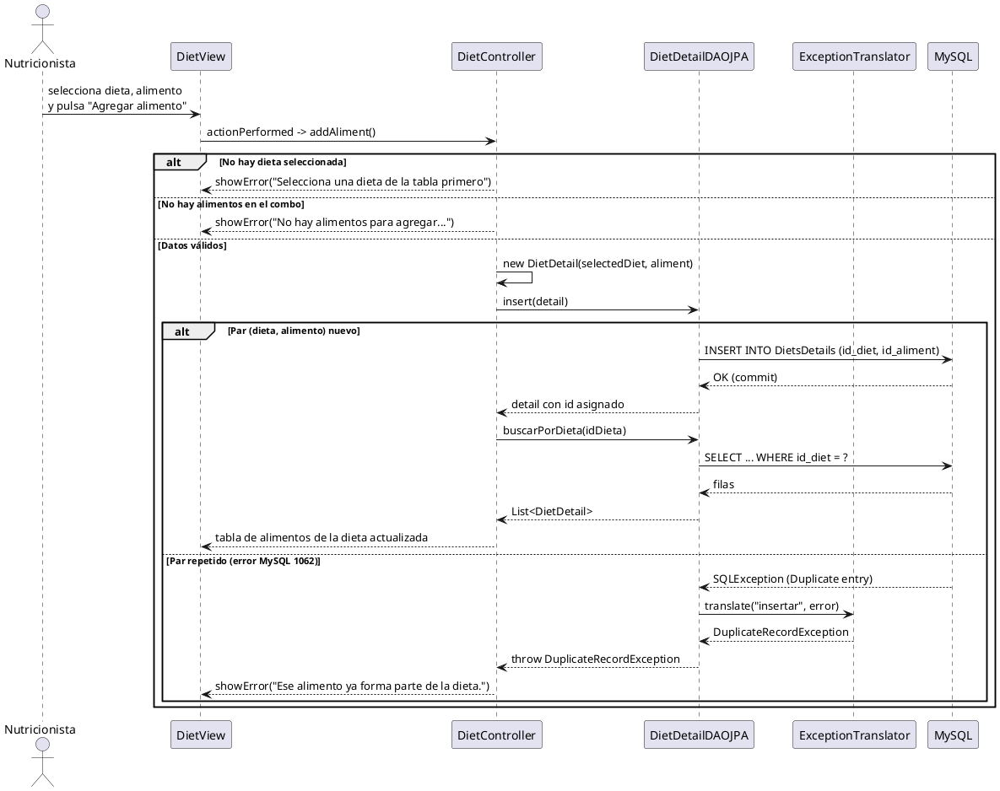

# Diagramas UML: Casos de Uso y Secuencia

> [!info] Qué es esta nota
> Los dos diagramas que exige la rúbrica, hechos por **Romi** y evaluados contra los PDFs de la cátedra. Cierran el **bloque E** de [[hoja-de-ruta-7-a-9]].
>
> **Veredicto: válidos y completos.** Las cuatro subtareas (E.1.1, E.1.2, E.2.1, E.2.2) están cubiertas.

> [!warning] Procedencia
> - **Del profesor:** la notación (actor con monigote, elipse, rectángulo del sistema, `include`/`extend`; líneas de vida, foco de control, mensajes y fragmentos `alt`) — `Diagrama_Casos_de_Uso_UML.pdf` pág. 4 a 11 y `Diagrama_de_Secuencia_UML.pdf` pág. 6 a 17.
> - **De Romi:** el contenido y el nivel de detalle de ambos diagramas.
> - **De la IA:** la transcripción a PlantUML de §4 y las observaciones de §3.

---

## 1. Qué hay

### 1.1 Casos de Uso General

- **Sistema:** rectángulo *"Sistema de Gestión de Nutrición"*.
- **Actor:** `Nutricionista` (monigote).
- **Módulos agrupados:** Pacientes, Dietas y Alimentos.
- **Casos:** 4 de Pacientes (incluye *Asignar dieta*), 7 de Dietas (incluye los del panel de alimentos) y 4 de Alimentos, más *Navegar entre módulos*.
- **Relaciones:**
  - `<<extend>>` de *Asignar dieta a paciente* hacia *Registrar paciente* y *Modificar paciente*.
  - `<<include>>` de *Eliminar dieta* → *Verificar que no tenga pacientes asignados*.
  - `<<include>>` de *Agregar alimento a la dieta* → *Verificar que el alimento no esté ya en la dieta*.
  - `<<include>>` de *Eliminar alimento* → *Verificar que no esté incluido en una dieta*.

### 1.2 Diagrama de Secuencia

- **Proceso elegido:** *Agregar alimento a la dieta*.
- **Participantes:** `Nutricionista`, `DietView`, `DietController`, `DietDetailDAOJPA`, `ExceptionTranslator`, `MySQL`.
- **Mensajes numerados 1 a 19**, con dos fragmentos `alt`:
  - El de las validaciones previas: sin dieta, sin alimentos, datos válidos.
  - El del resultado del `INSERT`: par nuevo (commit) o par repetido (`1062`).
- **Camino de error completo:** `SQLException` → `translate(...)` → `DuplicateRecordException` → `showError(...)`.

---

## 2. Evaluación contra la rúbrica

| Checklist | Estado | Detalle |
|---|---|---|
| **E.1.1** Rectángulo del sistema y actor | ✅ | *"Sistema de Gestión de Nutrición"* + `Nutricionista` |
| **E.1.2** Casos para las tres entidades y `<<include>>` | ✅ | los tres CRUD completos y los `include` de verificación |
| **E.2.1** Participantes de las capas | ✅ | View → Controller → DAO → BD (+ traductor de excepciones) |
| **E.2.2** Llamadas, retornos y `alt` de éxito/error | ✅ | dos `alt`, guardas entre corchetes y retorno punteado |

> [!tip] Lo más valioso para la defensa
> Las tres verificaciones incluidas **son las que existen en el código**:
> - *Eliminar dieta* → guarda con `patientDao.buscarPorDieta` (la del bug H1).
> - *Agregar alimento* → `UNIQUE (id_diet, id_aliment)` → `DuplicateRecordException`.
> - *Eliminar alimento* → `RecordInUseException` por la FK.
>
> Se puede abrir el diagrama y el código en paralelo y mostrar que coinciden.

---

## 3. Observaciones menores

| # | Observación | Gravedad |
|---|---|---|
| 1 | En el diagrama de secuencia el **actor aparece dos veces** (monigote arriba y abajo, sobre la misma línea de vida). En UML el actor tiene una sola línea de vida; abajo se repite el nombre, no el dibujo. | cosmética |
| 2 | Los **rectángulos punteados por módulo** no son notación UML: un paquete se dibuja como carpeta. Se entiende igual. | cosmética |
| 3 | `<<extend>>` de *Asignar dieta* es defendible (es opcional al registrar o modificar), aunque un purista lo modelaría como caso propio. La flecha está bien orientada. | aceptable |
| 4 | *"Verificar que…"* como casos de uso no aportan valor al actor; en UML estricto son reglas internas. El profesor usa `<<include>>` justamente para esto (pág. 8-11). | aceptable |

Ninguna obliga a rehacer nada.

---

## 4. Fuente PlantUML (reconstrucción)

> [!warning] Esto no es lo que hizo Romi
> Es una **transcripción** de las imágenes a PlantUML, para tener el diagrama en texto editable (y poder corregir el actor duplicado). Si Romi tiene el fuente original (`.puml` o `.drawio`), ese manda.

### 4.1 Casos de Uso

### 4.2 Secuencia — *Agregar alimento a la dieta*

---

## 5. Dónde guardar las imágenes

Las imágenes originales de Romi van en `tarea/diagramas/` del vault:

- `casos-de-uso.png`
- `secuencia-agregar-alimento.png`

Y en el zip de entrega, en una carpeta `diagramas/` junto al `LEEME.txt`.

---

## 6. Lo que falta de este bloque

Nada de contenido. Sólo decidir si se corrigen las dos observaciones cosméticas (§3, puntos 1 y 2) y guardar las imágenes.

---

## Relacionado

- [[hoja-de-ruta-7-a-9]] — bloque E, con los checklist que esta nota cierra
- [[Diagrama_Casos_de_Uso_UML]] — la fuente del profesor
- [[Diagrama_de_Secuencia_UML]] — la fuente del profesor, con el ejemplo MVC + DAO de la pág. 14 a 17
- [[plan-de-pruebas-crud]] — las verificaciones del diagrama, con sus casos
- [[cambios-sobre-codigo-de-romi]] — qué código suyo se tocó
- [[enunciado_rubrica]] — el requisito
- [[MAP]] · [[index]]
